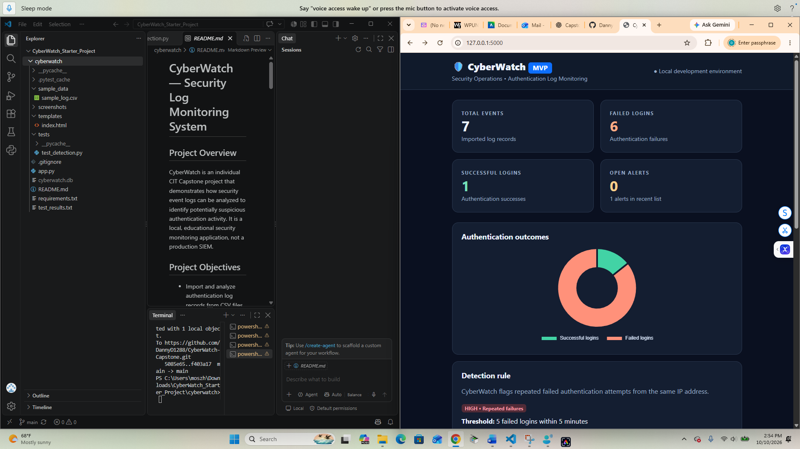

# CyberWatch — Security Log Monitoring System

## Project Overview
CyberWatch is an individual CIT Capstone project that demonstrates how security event logs can be analyzed to identify potentially suspicious authentication activity. It is a local, educational security monitoring application, not a production SIEM.

## Project Objectives
- Import and analyze authentication log records from CSV files.
- Detect repeated failed login attempts from the same IP address.
- Display authentication statistics and security alerts.
- Allow users to search and filter log events and alerts.
- Track alert resolution status.
- Validate detection logic using automated tests.

## Technologies Used
- Python and Flask
- SQLite
- HTML, CSS, JavaScript
- Bootstrap and Chart.js
- Pytest
- Git and GitHub
- Visual Studio Code

## Features

### Security Dashboard
Displays total events, successful logins, failed logins, and open alerts, along with an authentication outcomes chart.

### CSV Log Analysis
Imports synthetic authentication logs with the required columns: `timestamp`, `ip`, `username`, and `result` (`success` or `failure`). The upload limit is 2 MB.

### Detection Rule
Flags five failed authentication attempts from the same IP address within five minutes. Alerts indicate activity requiring review; they do not prove an attack occurred.

### Alert Management
Displays source IP, detection time, failed attempt count, severity, and status. Alerts can be marked resolved and filtered by status.

### Event Search
Supports searching authentication events and filtering by authentication result.

## How to Run Locally
1. Install Python 3.11 or later.
2. Open the `cyberwatch` project folder in Visual Studio Code.
3. Open the VS Code terminal.
4. Install dependencies: `python -m pip install -r requirements.txt`
5. Start the application: `python app.py`
6. Open `http://127.0.0.1:5000` in your browser.
7. Upload `sample_data/sample_log.csv` to demonstrate the detection rule.

## Automated Testing
Run `python -m pytest tests/test_detection.py -v` from the project folder.

Five automated detection tests passed on October 10, 2026:
1. Five failed logins trigger an alert.
2. Four failed logins do not trigger an alert.
3. Successful logins do not trigger an alert.
4. Failed logins from different IP addresses do not trigger an alert.
5. Five failed logins outside a five-minute window do not trigger an alert.

See `test_results.txt` for the recorded test output.

## Project Structure
```text
cyberwatch/
├── app.py
├── templates/
│   └── index.html
├── sample_data/
│   └── sample_log.csv
├── tests/
│   └── test_detection.py
├── requirements.txt
├── test_results.txt
├── .gitignore
└── README.md
```

## Current Scope and Limitations
CyberWatch processes uploaded synthetic CSV files. It does not provide continuous real-time monitoring, production authentication, or automated incident response. The application is intended for local demonstration and educational testing.

## Future Enhancements
- Additional detection rules and configurable thresholds.
- Exportable security alert reports.
- Improved error handling and additional automated tests.
- Dashboard screenshots and final capstone demonstration documentation.

## Repository
https://github.com/DannyD1288/CyberWatch-Capstone

## Academic Purpose
Developed as an individual Computer Information Technology Capstone project at William Paterson University.
## Dashboard Screenshot

The CyberWatch dashboard displays authentication statistics,
security alerts, and recent login activity.

